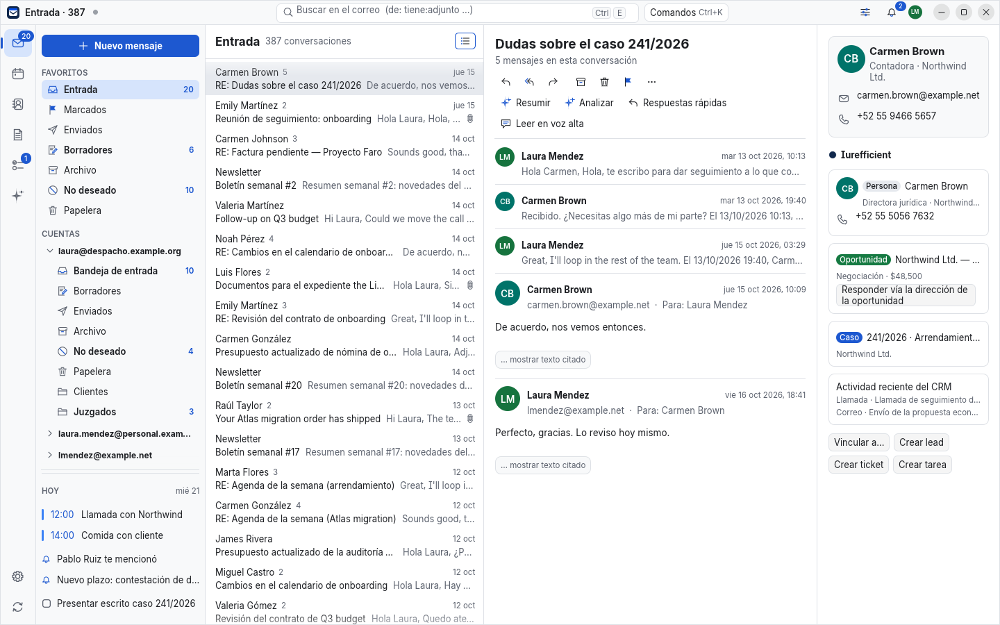
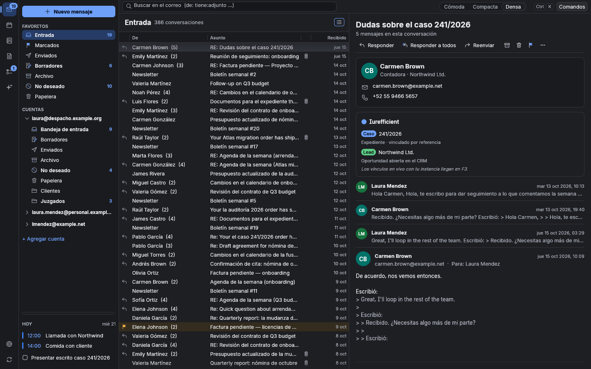
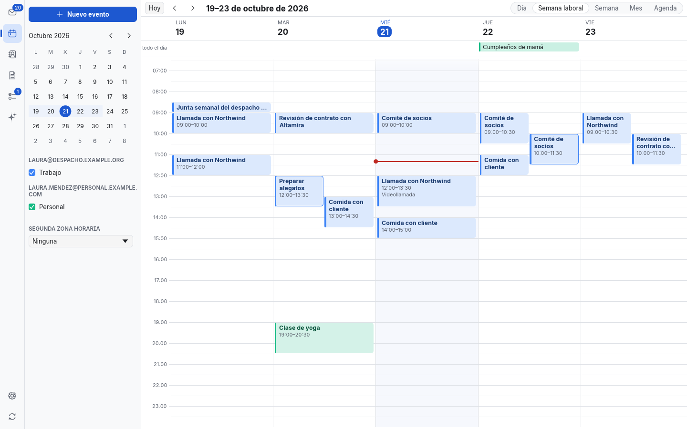
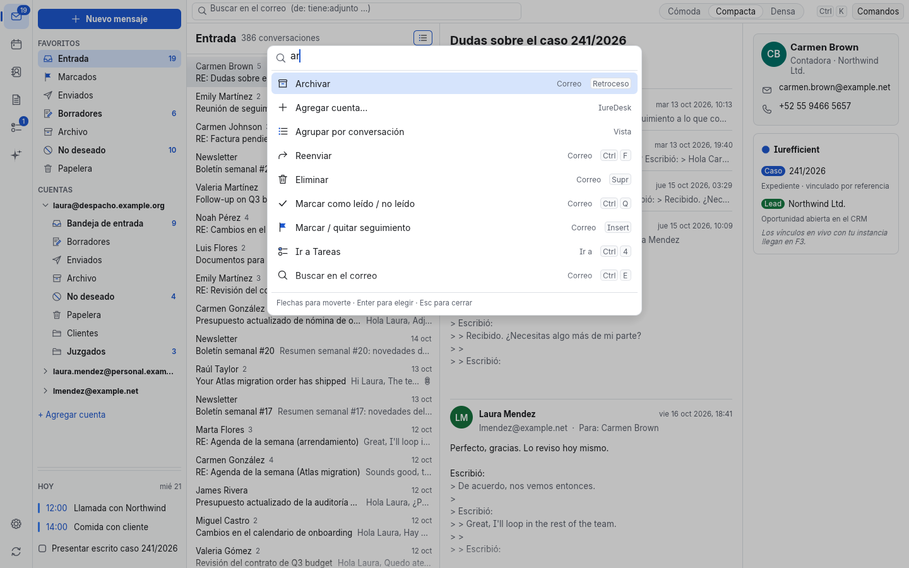

# IureDesk

**Gestor de información personal de escritorio, 100 % Rust** — correo, calendario, contactos,
notas y tareas — hecho para sustituir a Outlook, Thunderbird o Apple Mail a cualquier persona, con
más información en pantalla que cualquiera de ellos, y para ser la puerta de escritorio del
ecosistema Iurefficient. Linux primero; macOS y Windows después. [English version](README.md).

| Correo (claro, compacta) | Correo (oscuro, densa) |
|---|---|
|  |  |
| **Calendario** | **Paleta de comandos (Ctrl+K)** |
|  |  |

Más capturas (todos los módulos, en claro y oscuro) en [`docs/screens/`](docs/screens).

## Qué es

- **Funciona sin Iurefficient.** Cualquier cuenta IMAP/SMTP, Gmail, Microsoft 365 o iCloud:
  escribes tu correo, IureDesk encuentra la configuración y muestra **un solo** botón.
- **Denso y tranquilo.** Tres densidades (la densa muestra más filas que Outlook), temas claro,
  oscuro y de alto contraste que siguen al escritorio en vivo, sin cinta: barra de ≤ 6 acciones y
  una paleta de comandos (`Ctrl+K`) que llega a todo.
- **Teclado primero, con las teclas que ya conoces**: atajos de Outlook, Gmail o Apple Mail.
- **Deshacer siempre**: archivar, eliminar, mover, banderas, tareas.
- **Offline-first**: todo se lee del almacén local (redb + tantivy); las acciones van a una cola
  local que la sincronización replica.
- **Privado**: el correo HTML se pinta con Blitz (sin webview ni JavaScript) y las imágenes
  remotas quedan bloqueadas hasta que las pides.
- **Rust puro**, sin bibliotecas de C ni webview; bilingüe (español/inglés).

## Pruébalo

```sh
cargo run -p iuredesk -- --sample      # buzón de ejemplo: 3 cuentas, ~1 900 mensajes, agenda, contactos…
cargo run -p iuredesk                  # tus cuentas (la primera vez abre el asistente de alta)
cargo run -p iuredesk -- mailto:ana@example.com?subject=Hola
```

Capturas sin pantalla: `cargo run -p iuredesk-ui --example ui_shot -- /tmp/shot.png --module calendar --dark`.
Puerta de calidad: `cargo xtask ci`. El plan está en [`PLAN.md`](PLAN.md) y la lista de trabajo en
[`docs/gaps.md`](docs/gaps.md).

## Microsoft Store (MSIX)

El job de Windows de `.github/workflows/release.yml` arma también el paquete MSIX para Microsoft
Store y deja dos artefactos (no van a la release; el job «Release» sólo toma los `iuredesk-*`):

- `msix-store`: `IureDesk_<versión>-windows-x64.msix`, sin firmar, para subir a Partner Center
  (la Store lo firma).
- `msix-prueba`: el mismo paquete firmado con un certificado de prueba y su `.cer`. Para
  instalarlo a mano: importar el `.cer` en *Equipo local → Personas de confianza* y abrir el
  `.msix`.

Lleva lo mismo que instalan el `.exe` y el `.msi` (`iuredesk.exe`, `iuredesk.ico`, `LICENSE.md`,
`NOTICE`, `README.txt`, `THIRD-PARTY-NOTICES.txt`); no hay DLL ni programas auxiliares. Antes de
subirlo, el flujo valida el XML del manifiesto, instala la copia de prueba y, dentro del paquete
(por el alias `iuredesk`), comprueba `iuredesk --version` (que además dice si se detecta
empaquetada), que `iuredesk --mcp` conteste a `initialize`, y que la ventana abra; luego la
desinstala. Se puede lanzar a mano con *Run workflow* (`workflow_dispatch`) sin publicar nada.

La identidad sale de Partner Center (*Identidad del producto*) y va en tres variables del repo
(*Settings → Secrets and variables → Actions → Variables*): `MSIX_IDENTITY_NAME`
(`Package/Identity/Name`), `MSIX_PUBLISHER` (`CN=…`) y `MSIX_PUBLISHER_DISPLAY_NAME`. Sin ellas el
paquete lleva una identidad de prueba que Partner Center rechaza. El `DisplayName` del manifiesto
(`packaging/msix/AppxManifest.xml`) es «IureDesk», el nombre reservado; idiomas `es-MX` y `en-US`
(la app es bilingüe; la ficha de la Store necesita los dos).

**Versión del paquete** (`cargo xtask msix-version`, `xtask/src/msi.rs`): la Store no acepta un
primer número 0 y exige el cuarto en 0, así que es la `ProductVersion` del `.msi` con el primer
número más 1 y `.0` al final; la preliminar va en el tercer número para que cada beta, la
candidata y la final crezcan: `0.1.0-alpha.N` → `1.1.N.0`, `0.1.0-beta.N` → `1.1.(300+N).0`
(`beta.11` → `1.1.311.0` < `beta.12` → `1.1.312.0`), `0.1.0-rc.N` → `1.1.(600+N).0`, `0.1.0` →
`1.1.999.0`, `0.1.1` → `1.1.1999.0`, `1.0.0` → `2.0.999.0`. Cada envío necesita una versión mayor
que la anterior.

Diferencias con la versión del instalador:

- **Capacidades:** `runFullTrust` (app de escritorio Win32) e `internetClient`. Sin micrófono
  (IureDesk no graba; graban IureTranscribe e IureVoz) y sin `unvirtualizedResources`.
- **Lo que el instalador escribe en el registro** (protocolo `iuredesk:`, `mailto:`, `.eml`,
  `.ics` y `.vcf` en «Aplicaciones predeterminadas» y «Abrir con», el AppUserModelID de los
  avisos) **lo declara el manifiesto**, y empaquetada la app no escribe nada de eso: los avisos
  usan la identidad del paquete (`crates/desktop/src/notify.rs`). Windows no deja que nadie se
  imponga como cliente de correo: el usuario lo elige.
- **Inicio con la sesión:** la StartupTask `IureDeskInicio`, apagada por omisión; *Ajustes →
  General* la enciende con `Windows.ApplicationModel.StartupTask` y Windows la muestra en
  *Configuración → Aplicaciones → Inicio*. Como no pasa argumentos, «Iniciar minimizado» se
  recuerda en un archivo de la carpeta de configuración (`crates/desktop/src/autostart.rs`).
- **Línea de comandos y MCP:** el alias `iuredesk` (`%LOCALAPPDATA%\Microsoft\WindowsApps\iuredesk.exe`)
  es lo que se registra en Claude Desktop y VS Code, porque la carpeta del paquete cambia con cada
  versión y, lanzado por su ruta, el ejecutable corre sin la identidad del paquete (no vería el
  almacén). La configuración de Claude Desktop se reescribe en su sitio
  (`crates/mcp-server/src/agents.rs`).
- **Actualizaciones:** las hace la Store. Empaquetada, IureDesk no consulta GitHub ni avisa de
  versiones nuevas (*Ajustes* sólo dice que la actualiza la Store) y nunca descarga ejecutables;
  para invitar a instalar otra app de la suite abre su búsqueda en la Store en vez de la página de
  GitHub. Se detecta con `Windows.ApplicationModel.Package.Current` (`crates/desktop/src/store.rs`).
- **Datos:** el almacén, las preferencias y las cachés van al `AppData` virtualizado del paquete y
  se borran al desinstalar; las notas en `Documentos\IureDesk` y las credenciales del
  Administrador de credenciales (compartidas con la suite) no se virtualizan. Limitación: la
  «cuenta activa» de Iurefficient compartida con las demás apps
  (`%APPDATA%\iurefficient\cuenta-activa.json`) sólo se comparte si otra app de la suite la creó
  antes (un archivo nuevo quedaría en la copia privada del paquete; modificar uno existente sí
  llega al real). La solución de iureapps (lanzar un proceso fuera del contenedor) necesita
  `unsafe`, que este repo no permite fuera de `iuredesk-macos-events`. La sesión en sí está en el
  llavero y sí se comparte.
- **Apps hermanas:** las que vienen de la Store se encuentran y se lanzan por su alias (corren con
  su propia identidad). Las instaladas con su instalador, lanzadas desde IureDesk empaquetada,
  corren dentro del contenedor de IureDesk: ven el `AppData` real pero lo que creen ahí queda en el
  de IureDesk, y la grabación de IureTranscribe podría no tener permiso de micrófono.

La política de privacidad de la ficha de la Store es [`PRIVACY.md`](PRIVACY.md)
(<https://github.com/ellaguno/iuredesk/blob/main/PRIVACY.md>).

## Licencia

[Apache-2.0](LICENSE.md),
© Eduardo Llaguno Velasco.
