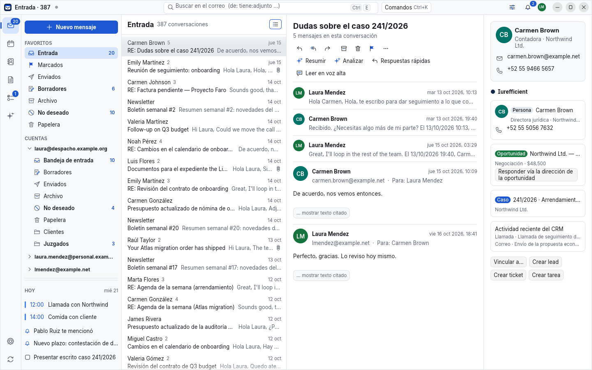
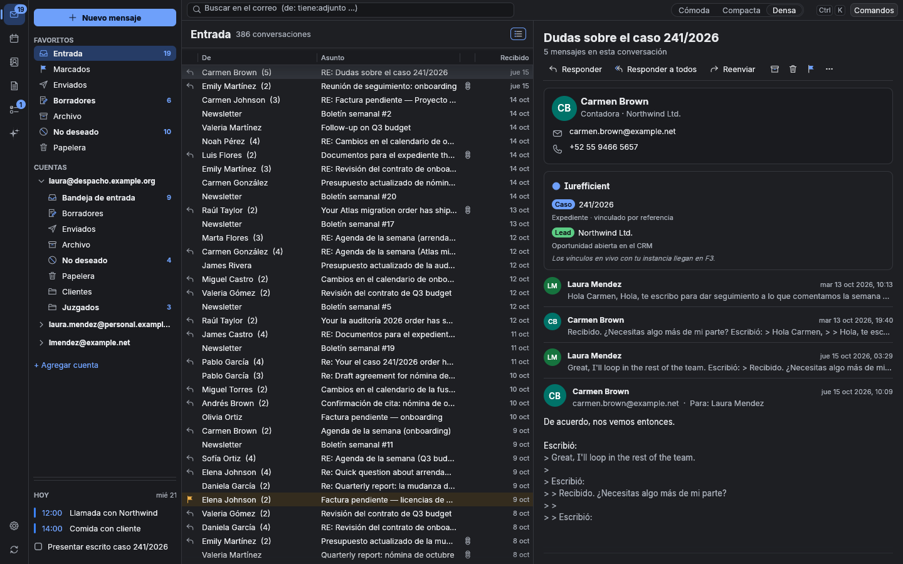
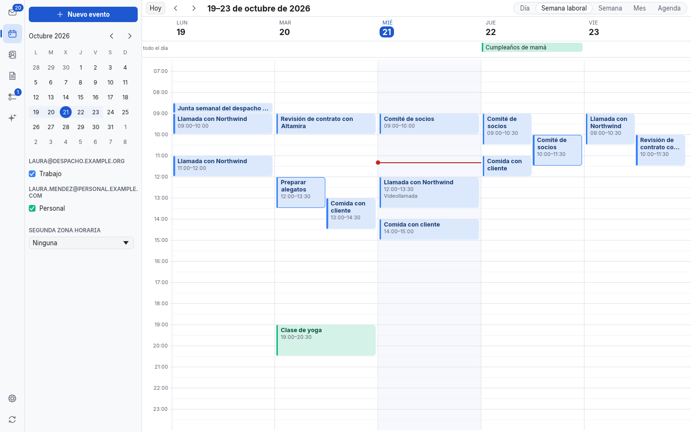
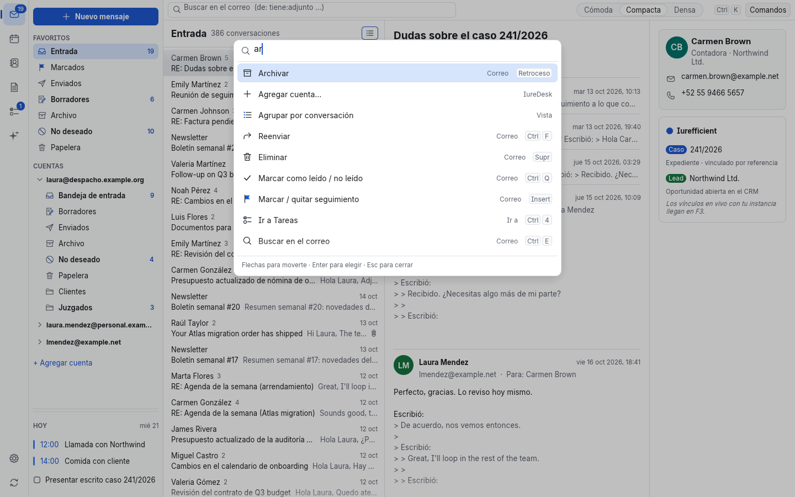

# IureDesk

**A 100 % Rust desktop PIM** — mail, calendar, contacts, notes and tasks — built to replace
Outlook, Thunderbird or Apple Mail for anyone, with more information on screen than any of them,
and to be the desktop hub of the Iurefficient ecosystem. Linux first; macOS and Windows next.
[Versión en español](README.es.md).

| Mail (light, compact) | Mail (dark, dense) |
|---|---|
|  |  |
| **Calendar** | **Command palette (Ctrl+K)** |
|  |  |

More screenshots (every module, light and dark) in [`docs/screens/`](docs/screens).

## What it is

- **Works without Iurefficient.** Any IMAP/SMTP account, Gmail, Microsoft 365 or iCloud: type
  your address and IureDesk finds the settings, then shows **one** button.
- **Dense and calm.** Three densities (the dense one fits more rows than Outlook), light, dark and
  high-contrast themes that follow your desktop live, no ribbon: a ≤ 6-button action bar plus a
  command palette (`Ctrl+K`) that reaches everything.
- **Keyboard first, with the keys you already know**: Outlook, Gmail or Apple Mail shortcuts.
- **Undo everything**: archive, delete, move, flags, tasks.
- **Offline-first**: everything reads from the local store (redb + tantivy); actions go to a local
  queue that sync replays.
- **Private**: HTML mail is rendered with Blitz (no webview, no JavaScript) and remote images
  stay blocked until you ask.
- **Pure Rust**, no C libraries, no webview; bilingual (English/Spanish).

## Try it

```sh
cargo run -p iuredesk -- --sample      # demo mailbox: 3 accounts, ~1 900 messages, calendar, contacts…
cargo run -p iuredesk                  # your accounts (first run shows the add-account assistant)
cargo run -p iuredesk -- mailto:ana@example.com?subject=Hello
```

Headless screenshots: `cargo run -p iuredesk-ui --example ui_shot -- /tmp/shot.png --module calendar --dark`.
Quality gate: `cargo xtask ci`. The plan is in [`PLAN.md`](PLAN.md) and the work list in
[`docs/gaps.md`](docs/gaps.md).

## License

[Apache-2.0](LICENSE.md),
© Eduardo Llaguno Velasco.
